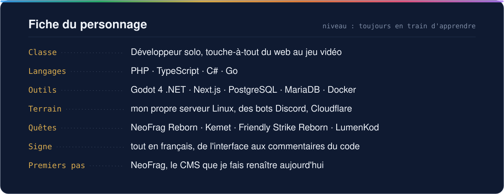
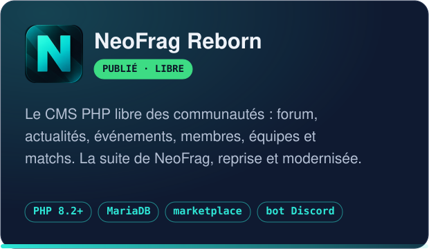
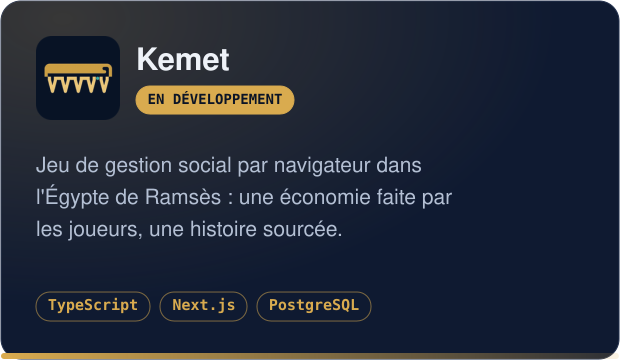
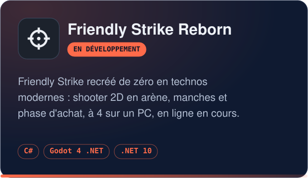
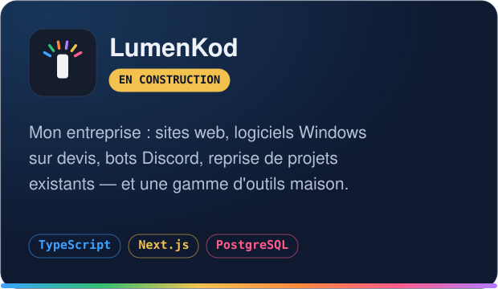
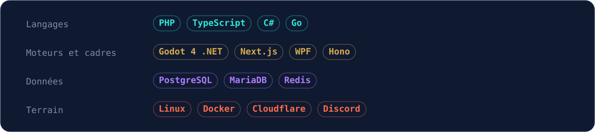
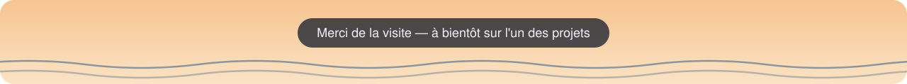

### Bonjour, moi c'est Luandre 👋

Développeur solo, je travaille sur ce qui me tient à cœur : un **CMS libre** pour les communautés de joueurs,
un **jeu de gestion** dans l'Égypte antique, le **remake de Friendly Strike** et une **entreprise** qui se monte
pas à pas. Le fil rouge : reprendre ce qui en vaut la peine et le faire renaître, proprement, en français.

## Les quêtes en cours

> Kemet, Friendly Strike Reborn et LumenKod se construisent pour l'instant en privé : ils arriveront ici quand
> ils seront prêts à être montrés.

## Ce qu'il y a sur l'établi

<b>Au fond de l'atelier</b>

 

Des projets plus petits, rangés pour l'instant :

- **Blah** — voix et discussion sur son propre serveur (Go) ;
- **Lister** — téléchargeur et convertisseur de playlists (C#) ;
- **LoL-Idea** — théorycraft League of Legends : données du jeu, moteur de combat, analyse en direct (C#, WPF).

<b>Là où tout a commencé</b>

 

Mes premiers pas dans le développement, je les ai faits sur **NeoFrag**. Aujourd'hui, je le fais renaître :
c'est **NeoFrag Reborn**, repris et modernisé, toujours libre.

 

